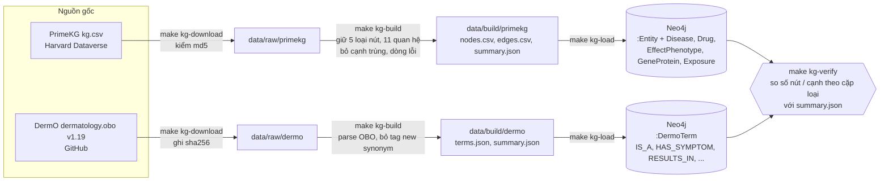
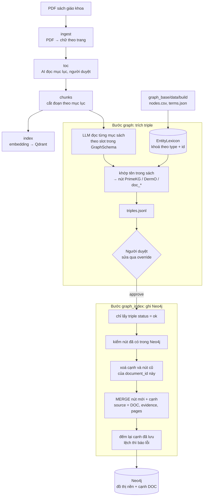
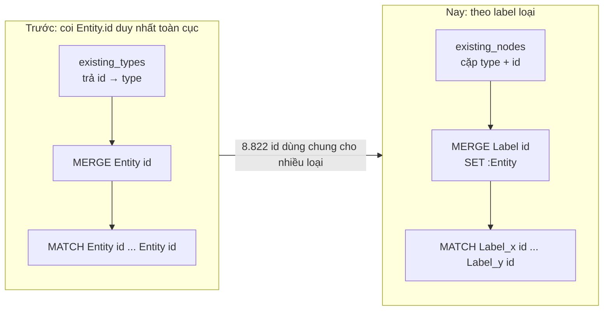
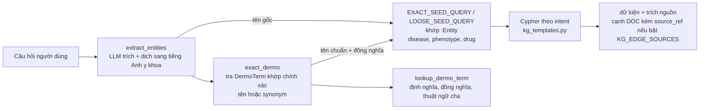

# Flow đồ thị tri thức: từ nguồn gốc, qua trích xuất từ sách, đến lúc agent truy vấn

Sơ đồ Mermaid. Nét đứt cam = **chưa làm**. Phần luồng trích tự động (khớp theo `(loại, id)`, lexicon từ `graph_base`) đã sửa trong code, chưa chạy với Neo4j thật. Schema và số liệu: [knowledge-graph.md](knowledge-graph.md).

## 1. Dựng đồ thị nền (`core/graph_base/`)

## 2. Trích quan hệ từ sách vào đồ thị (`document_ingest`)

### Cách `graph_index` nhận diện nút (đã sửa)

## 3. Hai đồ thị gặp nhau thế nào (lúc agent truy vấn)

Không có cạnh nối `:Entity` với `:DermoTerm`; cầu nối duy nhất là so khớp tên.

## Chú thích
- Chạy `make kg-load reset=1` xoá cả cạnh `DOC`; sau đó phải chạy lại bước `graph_index` cho từng sách.
- `GRAPH_LEXICON_DIR` mặc định trỏ `core/graph_base/data/build` (cần chạy `make kg-build` trước khi chạy bước `graph`).
- Cạnh `DOC` chỉ hiện với agent khi `KG_EDGE_SOURCES` có `DOC` (mặc định `["KG"]`).
