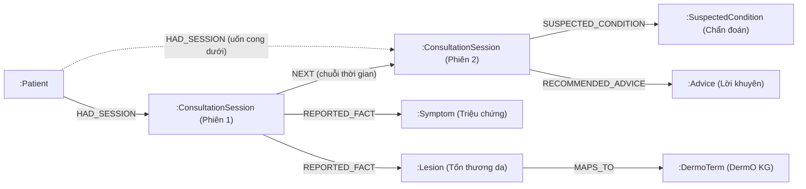

# Module Đồ thị hành trình bệnh nhân (Patient Journey Knowledge Graph)

Mỗi bệnh nhân có một đồ thị tri thức cá nhân (Personal Knowledge Graph - PJKG) được lưu trữ trên **Neo4j**, xâu chuỗi liên tục qua các phiên tư vấn (`ConsultationSession`). Bác sĩ có thể quan sát trực quan toàn bộ diễn tiến bệnh, triệu chứng cơ năng, tổn thương thực thể và các chỉ định/lời khuyên qua từng đợt khám.

> Đồ thị chỉ phục vụ tham khảo và hỗ trợ bác sĩ nắm bắt bệnh sử nhanh chóng; **không thay thế chẩn đoán y khoa**.

---

## 1. Code nằm ở đâu

| Lớp | File | Vai trò |
|---|---|---|
| **FE Components** | `fe/features/doctor/components/PatientJourneyDialog.tsx` | Dialog tổng chứa bộ lọc, thống kê và chuyển đổi 2 chế độ (Đồ thị mạng / Dòng thời gian) |
| | `fe/features/doctor/components/PatientJourneyCanvas.tsx` | Vẽ đồ thị SVG theo trục xương sống thời gian, hỗ trợ zoom/pan, auto-fit view |
| | `fe/features/doctor/components/PatientJourneyTimeline.tsx` | Chế độ xem thẻ timeline chi tiết từng phiên |
| **FE API & Hooks** | `fe/features/doctor/api.ts` (`getPatientJourneyGraph`) | Gọi API lấy dữ liệu đồ thị |
| | `fe/features/doctor/hooks.ts` (`usePatientJourneyGraph`) | TanStack Query hook query theo `patientId` |
| **API Backend** | `core/app/api/doctor_api.py` | `GET /api/v1/doctor/patient-profiles/{profile_id}/journey-graph` |
| **Service Backend** | `core/app/services/patient_graph_service.py` | Quản lý Cypher queries đồng bộ và truy vấn graph từ Neo4j |
| | `core/app/services/consultation_service.py` | Gọi sync phiên & facts tiền tư vấn |
| | `core/app/services/finalize_report_service.py` | Gọi sync chẩn đoán & lời khuyên khi bác sĩ đóng ca |
| **DTO Backend** | `core/app/dto/response/patient_graph.py` | `PatientJourneyGraphOutput`, `GraphNodeOutput`, `GraphEdgeOutput` |

---

## 2. Mô hình dữ liệu trong Neo4j

### 2.1 Các loại nút (`Nodes`)

- `:Patient`: Node gốc của bệnh nhân (`id`, `gender`, `dob`).
- `:ConsultationSession`: Phiên tư vấn của ca khám (`id`, `date`, `status`, `reason`, `summary`).
- `:ClinicalFact` / `:Symptom` / `:Lesion`: Dữ kiện lâm sàng được AI trích xuất (`id`, `name`, `detail`, `type`, `status`).
- `:SuspectedCondition`: Chẩn đoán nghi ngờ do bác sĩ chốt khi đóng ca (`id`, `name`).
- `:Advice`: Lời khuyên, hướng dẫn điều trị do bác sĩ chỉ định (`id`, `content`).
- `:DermoTerm`: Thuật ngữ da liễu trong đồ thị y khoa chuẩn (DermO) được ánh xạ từ dữ kiện.

### 2.2 Các loại quan hệ (`Edges`)



- `(Patient)-[:HAD_SESSION]->(ConsultationSession)`: Bệnh nhân tham gia phiên tư vấn.
- `(ConsultationSession)-[:NEXT]->(ConsultationSession)`: Nối phiên cũ sang phiên kế tiếp theo thứ tự thời gian (`prev.date < s.date`).
- `(ConsultationSession)-[:REPORTED_FACT]->(ClinicalFact)`: Dữ kiện lâm sàng ghi nhận trong phiên.
- `(ClinicalFact)-[:MAPS_TO]->(DermoTerm)`: Liên kết thực thể với ontology DermO nền (nếu có).
- `(ConsultationSession)-[:SUSPECTED_CONDITION]->(SuspectedCondition)`: Bệnh lý bác sĩ chốt.
- `(ConsultationSession)-[:RECOMMENDED_ADVICE]->(Advice)`: Dặn dò bác sĩ chỉ định.

---

## 3. Luồng đồng bộ dữ liệu vào Đồ thị

```
1. Bệnh nhân yêu cầu tư vấn / AI sinh báo cáo tiền tư vấn
   └─► ConsultationService.create_pre_consultation_report()
         └─► PatientGraphService.upsert_session_with_facts(patient_id, session_id, facts, ...)
               ├─ MERGE (p:Patient {id: $patient_id})
               ├─ MERGE (s:ConsultationSession {id: $session_id})
               ├─ MERGE (p)-[:HAD_SESSION]->(s)
               ├─ Tự tìm phiên liền trước gần nhất: MERGE (prev)-[:NEXT]->(s)
               └─ Nối các :ClinicalFact qua quan hệ [:REPORTED_FACT]

2. Bác sĩ tư vấn & hoàn tất đóng ca
   └─► FinalizeReportService.finalize_session()
         └─► PatientGraphService.sync_session_finalization(session_id, conditions, instructions)
               ├─ MATCH (s:ConsultationSession {id: $session_id})
               ├─ MERGE (c:SuspectedCondition) & MERGE (s)-[:SUSPECTED_CONDITION]->(c)
               └─ MERGE (a:Advice) & MERGE (s)-[:RECOMMENDED_ADVICE]->(a)
```

---

## 4. Giao diện trực quan hoá (Frontend)

Dialog hành trình bệnh nhân tại `/doctor` cung cấp 2 góc nhìn:

### 4.1 Đồ thị mạng (`PatientJourneyCanvas.tsx`)
- **Trục xương sống**: Các phiên tư vấn (`Phiên 1`, `Phiên 2`...) được xếp nối tiếp nhau theo hàng ngang từ trái sang phải qua đường nét đứt `NEXT`.
- **Phân bổ vệ tinh**:
  - Triệu chứng (`Symptom`) và tổn thương (`Lesion`): Tỏa lên phía trên của từng phiên tương ứng.
  - Chẩn đoán (`SuspectedCondition`) và dặn dò (`Advice`): Tỏa xuống phía dưới của từng phiên.
- **Cơ chế Auto-Fit View (`fitView`)**:
  - Bọc toàn bộ các phần tử đồ thị trong nhóm `<g transform="translate(pan.x, pan.y) scale(zoom)">`.
  - Tích hợp `ResizeObserver` trên khung chứa, tự động tính bounding box của mọi node để co giãn tỷ lệ và căn giữa toàn bộ đồ thị khi mở dialog hoặc thay đổi kích thước cửa sổ.
  - Toolbar hỗ trợ nút **Vừa khung nhìn (Fit view)**, Phóng to/Thu nhỏ và Đặt lại 100%.
- **Uốn cong cạnh `HAD_SESSION`**: Các đường nối từ Bệnh nhân tới các phiên sau được uốn cong theo đường Bezier chúc xuống dưới, tránh đè xuyên tâm các phiên đứng trước.

### 4.2 Dòng thời gian (`PatientJourneyTimeline.tsx`)
- Hiển thị theo dạng danh sách mốc sự kiện (cards timeline) từ phiên đầu tiên tới phiên mới nhất.
- Bác sĩ có thể đọc chi tiết từng triệu chứng ghi nhận, chẩn đoán xác định và lời khuyên của từng đợt khám.
